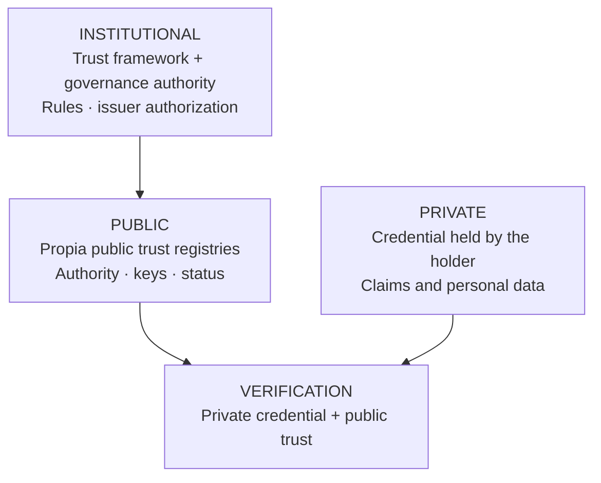
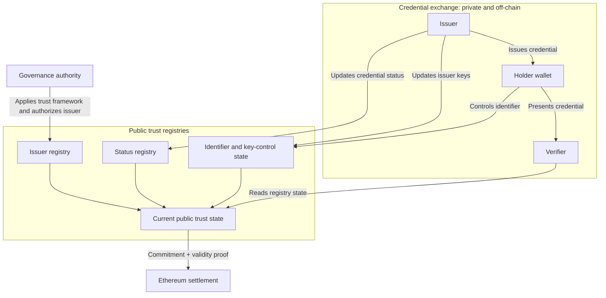

# Propia

## A Public Trust Layer for Verifiable Digital Credentials

**Propia Protocol Whitepaper, Version 1.0, 2026**

### Abstract

People and institutions repeatedly prove and verify the same facts. A person whose identity has already been established by a government must often submit similar evidence again to a university, bank, employer, or public agency. Each organization repeats part of the verification, stores additional copies of personal data, and maintains separate connections to issuers or intermediaries. This raises operating costs, delays service delivery, creates availability dependencies, and expands the potential impact of data breaches. Generative AI increases the urgency of the problem by making convincing documents and synthetic identities inexpensive to produce.

Verifiable digital credentials make the results of institutional verification reusable. A public authority can issue proof of identity; a university can rely on that credential and issue a diploma; and a professional body can verify both and issue a licence. Each institution remains responsible for its own decision, but can build on evidence already verified by another authorized institution instead of starting from zero. People avoid repeating the same procedures, while institutions can create new services from independently verifiable credentials. This makes institutional verification reusable and composable.

Existing standards define how digital credentials are issued, represented, and presented. Portability alone, however, does not create shared trust. Verifiers must still determine whether an issuer is institutionally authorized for a particular claim, which keys represent it, whether a credential remains valid, and which governance process is responsible for those decisions.

Propia provides the public trust layer required to resolve this gap. Its public trust registries make institutional authorizations, key-control information, and credential status independently verifiable. Credential payloads and personal claims are not stored in these registries; they remain under the holder’s control and are presented directly to verifiers. Credential standards make institutional claims portable. Propia makes the authority behind those claims independently verifiable.

This shared trust layer must serve many institutions without becoming another centralized platform or requiring a network of bilateral integrations. Propia uses blockchain infrastructure to maintain a common and independently verifiable state, while Layer 2 execution aggregates registry updates at population scale. Ethereum verifies validity proofs and provides final settlement for the resulting state commitments. The common registry reduces integration and synchronization costs, while blockchain allows institutions to verify its accepted state without depending on a privileged operator.

Institutional authority remains with the governance authorities and issuers operating under defined trust frameworks. Propia represents the resulting trust state; it does not create that authority. The protocol is conceived as public infrastructure, with open specifications, transparent governance, and practical exit rights for institutions and users.

---

## 1. From Repeated Verification to Reusable Credentials

Most institutional verification processes start from the beginning. A citizen submits similar documents to a bank, an insurer, and a government portal. Each organization performs its own checks and often stores another copy of the same personal data.

With a reusable credential, an authorized institution verifies a fact and issues a signed attestation to the person concerned. While the credential remains valid, the holder can present it to other verifiers. Each verifier checks the signature, the issuer's authority, the holder binding, and current status. Credentials can expire, be suspended, or be revoked, so reusability does not imply permanent validity.

This model reduces repeated verification and limits the number of systems that need to retain source documents. It also separates presentation from issuance, so verification does not require the issuer to learn about each subsequent use.

### Building on prior verification

The broader value appears when one institution can use another institution's signed output as an input to its own process.

A government may issue a foundational identity credential. A university can verify that credential and issue a diploma to the same holder. A professional body can verify the holder's foundational identity credential and diploma before issuing a licence. An employer, bank, or public agency can then verify the relevant credentials against the same public trust registries.

The institutions do not need access to each other's databases. Each participant verifies a standardized presentation, applies its own legal and administrative rules, and may issue another credential. This allows institutional processes to compose while each authority retains control over its own decisions and records.

The distinction between verification and authorization is important. Reading the public trust registries and verifying credentials can remain open. The authority to issue a regulated credential is governed by the relevant trust framework. Open verification therefore does not imply open issuance.

Composability also changes the integration model. In platform-based systems, a central operator mediates the relationships between issuers and verifiers. With shared protocols, institutions implement compatible interfaces and rely on public trust registries. New wallets, verification services, and applications can participate without obtaining approval from a central operator or exposing each presentation to it.

### Why this matters now

Three developments make this model both necessary and practical.

**Visual evidence is becoming less reliable.** Convincing document forgery once required specialized equipment, access, and skill. Digital editing lowered those barriers, and generative AI is lowering them further. Images, voices, signatures, and identity documents can appear authentic without a reliable connection to their purported source. [[1]](#ref-1)

**Portable digital credentials are ready for institutional use.** W3C, ISO, IETF, and OpenID specifications now define interoperable formats and protocols for issuing, presenting, and verifying credentials across systems. Digital signatures make alterations detectable and identify the signing key, while selective-disclosure mechanisms allow holders to reveal only the information required for a particular interaction. Institutions can adopt these capabilities without creating another proprietary credential format or exchange system. [[2]](#ref-2) [[3]](#ref-3) [[6]](#ref-6) [[8]](#ref-8) [[9]](#ref-9) [[10]](#ref-10)

**A shared public registry can now operate without a single controlling institution.** Public blockchains allow independent participants to verify the same state without assigning ownership of the canonical database to a protocol operator, issuer, or other intermediary. Layer 2 systems can aggregate large numbers of registry updates before settlement, reducing their marginal cost while credentials and personal data remain outside the blockchain. [[13]](#ref-13) [[14]](#ref-14) [[15]](#ref-15)

Together, these developments make it possible to keep credential exchange private while maintaining authority, key-control information, and credential status as shared and independently verifiable state.

---

## 2. Institutional Authority and the Missing Trust Layer

The internet provides protocols for moving information, addressing services, and securing connections. Durable claims about people and organizations depend on a different source of authority. Civil registries establish legal identity, universities award degrees, professional bodies grant licences, and public agencies issue permits.

In many digital systems, that authority can be verified only through a database lookup. A verifier contacts an issuer or an intermediary to confirm that a record exists. This approach has several recurring costs:

- **Observation of use.** An issuer that receives every verification request can learn when and where a credential is presented.
- **Availability dependencies.** Verification can fail when the issuer's service is unavailable.
- **Duplicated integrations.** Each verifier builds and maintains a separate connection to each issuer.
- **Duplicated personal data.** Verifiers often retain local copies of documents and attributes.
- **Provider dependence.** Access rules, pricing, and technical interfaces remain under the control of the platform operator.

Open credential standards reduce these dependencies. They define data models, signature formats, issuance flows, and presentation flows. They do not determine whether a particular key is authorized to issue a driver's licence, which governance authority can grant that authorization, or how a credential's current status should be made available to independent verifiers.

A trust framework is the body of legal, policy, governance, and operational rules under which institutions issue and accept credentials within a jurisdiction or domain. A governance authority applies those rules, including authorizing issuers and defining the scope of their authorization.

The Propia protocol represents and exposes the technical state needed to verify credentials under those rules, including issuer authorizations and their scope, key-control information, and credential status. It does not define the trust framework or create institutional authority.

A government remains responsible for a national identity credential, and a university remains responsible for a diploma. Propia's public trust registries record the identifiers and keys recognized for those institutions, the scope of their authorization, and the status information they publish. This allows separate systems to apply the same verification rules without requiring a private callback to an issuer or central service for each credential presentation.

At a high level, verification combines private credential data controlled by the holder with public trust information maintained by the protocol:

Private credential data never enters the public trust registries. A verifier combines the credential presented by the holder with public trust information from Propia's public trust registries.

---

## 3. Public Infrastructure Requirements

### Public-good commitments

Digital credential infrastructure affects access to public services, education, finance, employment, and civic life. A shared trust layer used in these contexts must remain usable and verifiable independently of any single vendor or operator. Treating the protocol layer as a public good therefore imposes concrete requirements on its design and operation. These requirements draw on established principles for inclusive and interoperable identification systems and on the Digital Public Goods Standard. [[19]](#ref-19) [[20]](#ref-20)

- **Open implementation.** Protocol specifications and core contracts must be publicly available for inspection and independent implementation. Reference software must be available under an open licence.
- **Open verification.** Reading the public trust registries and verifying credentials must not require a private agreement with a protocol operator or implementation provider.
- **Institutional exit rights.** Issuers must be able to change vendors, operate their own infrastructure, and preserve the usefulness of credentials already issued.
- **Transparent governance.** Changes to issuer authorization, protocol rules, and upgrade authority must be visible and auditable.
- **Data independence.** The protocol must not give any operator or implementation provider ownership of credential contents, personal data, or the institutional authority expressed through a credential.

Commercial services can operate above this common layer. Wallets, issuer portals, compliance tools, support, and managed infrastructure can compete on functionality and service quality.

### Operational continuity

Public credential infrastructures remain in use for much longer than individual applications, vendors, or administrations. Protocol portability and independent verification are therefore security and continuity requirements.

Credentials must remain interpretable across compatible wallets and verification software. Institutions must be able to reconstruct the verification environment from public trust registries, standard formats, open implementations, and independently verifiable settlement state. If an implementation provider stops operating a hosted component, other operators must be able to continue the functions required for resolution and verification.

Together, these requirements favor public trust registries with blockchain-based settlement over a database controlled by a single provider. Blockchain does not create institutional authority or store credential payloads. Its role is to make the accepted registry state and the rules governing its updates independently verifiable, while reducing reliance on a privileged operator.

The following sections describe how the credential model, public trust registries, and settlement architecture apply these constraints.

---

## 4. Credential Model and Lifecycle

Verifiable credential systems involve three roles:

| Role | Function |
|---|---|
| **Issuer** | Creates and signs a credential containing claims about a subject. |
| **Holder** | Receives the credential and controls its presentation, usually through a wallet. |
| **Verifier** | Requests information and validates the resulting presentation. |

The following lifecycle uses a government-issued driver's licence as an example.

### Issuance

The authorized issuer completes the applicable legal and administrative checks. It then creates a credential, binds it to the holder when required by the credential profile, signs it with an authorized institutional key, and delivers it through an issuance protocol.

The credential payload is not stored in the public trust registries. It may be held in the holder's wallet and in the issuer's own records according to applicable law and operational policy. Propia does not require a central protocol-level copy.

### Presentation

A verifier sends a request that identifies the required claims and the purpose of the interaction. The wallet displays the request to the holder and creates a presentation after consent.

Credential formats that support selective disclosure allow the wallet to omit claims that were not requested. An age check, for example, can use an issuer-provided `age_over_18` claim instead of disclosing a date of birth, address, document number, and photograph.

Selective disclosure should not be confused with arbitrary computation over hidden values. Proving that a concealed date satisfies an age threshold requires a credential profile that includes the relevant derived claim or a separate zero-knowledge predicate mechanism.

### Verification

The verifier evaluates:

1. **Integrity.** The signed credential has not been modified.
2. **Issuer authority.** The signing key belongs to an issuer authorized for the relevant credential type and trust framework.
3. **Holder binding.** The presenter satisfies the binding method defined by the credential.
4. **Temporal validity.** The credential is within its defined validity period.
5. **Status.** The credential has not been suspended or revoked.

These checks can be performed without a private callback to the issuer. A verifier can read the current state of the public trust registries directly or through independently operated infrastructure. Cached state can support disconnected or proximity scenarios, subject to a freshness policy. The acceptable age of cached revocation data is a deployment decision and should be explicit.

### Status

Issuers need a way to suspend or revoke credentials when their legal or factual basis changes. The relevant public trust registry records compact status information under the control of the issuer, using mechanisms compatible with credential status standards. Verifiers can observe an update without revealing the credential's claims or creating a protocol-level history of its presentations.

### Standards

The protocol is designed to interoperate with established credential formats, exchange protocols, and secure messaging standards:

- W3C Verifiable Credentials Data Model 2.0 and DID Core 1.0 [[3]](#ref-3) [[4]](#ref-4)
- SD-JWT (RFC 9901), together with the SD-JWT VC profile for selectively disclosable online credentials [[6]](#ref-6) [[7]](#ref-7)
- ISO/IEC 18013-5 mdoc for mobile and proximity credentials [[10]](#ref-10)
- OpenID4VCI 1.0 for issuance [[8]](#ref-8)
- OpenID4VP 1.0 for presentation [[9]](#ref-9)
- DIDComm Messaging 2.1 for secure, private, and transport-independent messaging when DID-based agent communication is required [[21]](#ref-21)
- W3C Bitstring Status List 1.0 for suspension and revocation [[5]](#ref-5)

Implementations should declare the versions, profiles, cryptographic suites, and optional features they support. The SD-JWT VC profile remains an IETF Internet-Draft as of July 2026, so deployments must account for possible changes before publication. [[6]](#ref-6) [[7]](#ref-7)

Using public, versioned standards allows credentials to be stored and presented through compatible wallets and verified by independent software. It also gives institutions a practical path to change providers without redefining the credential system.

---

## 5. Protocol Architecture

The protocol architecture separates private credential exchange from the public state required to verify institutional trust. Credentials, personal claims, and presentation histories remain between issuers, holders, and verifiers. Only the information that independent participants need to evaluate authority, identifier control, and credential status is maintained in public trust registries.

A valid signature proves that a particular key signed a credential, but it does not establish whether that key was authorized to issue the relevant type of claim. The public trust registries provide this institutional and operational context: which issuers are authorized under a given trust framework, which keys currently control an identifier, and whether a credential has been suspended or revoked.

Governance authorities apply the trust frameworks under which issuers are authorized. Issuers perform identity proofing, issue credentials directly to holders, and update credential status when necessary. Holders store and present credentials through compatible wallets, while verifiers read the public registry state required to validate them independently.

The architecture has the following components:

| Component | Responsibility |
|---|---|
| **Governance authority** | Applies the legal, policy, governance, and operational rules of a trust framework, including authorization criteria and the scope within which issuers may operate. |
| **Issuer registry** | Records issuer authorizations with a scope defined by credential type and trust framework. |
| **Identifier registry** | Records current verification methods, controllers, rotation and recovery rules, and the public information required to resolve an identifier. |
| **Status registry** | Records compact suspension and revocation state under the control of the issuer responsible for each credential. |
| **Issuer systems** | Perform identity proofing, sign credentials, deliver them to holders, and submit authorized state updates. |
| **Wallets and verifier software** | Store credentials, create presentations, resolve public trust registry state, and validate credentials and presentations against that state. |
| **Settlement layer** | Records accepted state commitments and verifies validity proofs, providing an independently verifiable reference for the accepted public trust state. |

Credential presentations are exchanged directly and are not recorded in the public trust registries. Credential data moves from the holder to the verifier using the selected exchange protocol. The verifier consults the registries to resolve keys, authorization, and status.

### Issuer authorization

Authorization is scoped. A transport authority may be authorized to issue driver's licences in one jurisdiction without being authorized to issue university degrees or licences elsewhere.

The applicable governance authority controls writes to the issuer registry under the rules of the trust framework. Permissionless self-registration would only prove that an entity controls a key. It would not establish the legal or institutional authority required for a regulated credential. Registry reads remain public, and changes to authorization state are auditable.

### Identifier control, rotation, and recovery

Some credential profiles bind a credential to a stable identifier rather than directly to a single device key. This separates continuity of control from the lifetime of an individual key. Wallets can use hardware-backed keys so that users can authorize operations without managing seed phrases. Transaction submission can be sponsored or relayed so that users do not need to acquire a native token.

Where this continuity is required, the identifier registry records the current verification methods and the rules under which control may change. Key rotation and recovery become explicit state transitions governed by contract rules. A recovery policy can require multiple approvals, delays, or other safeguards. The chosen policy determines the trust assumptions and should be visible to relying parties.

Credential continuity after rotation depends on the holder-binding method used by the credential. A credential bound to a stable identifier may remain usable after an authorized key update. A credential bound directly to a device key may require re-issuance.

Propia does not require a proprietary identifier format. Credential profiles may use W3C DIDs or another compatible identifier scheme, provided that control state and authorized changes can be resolved and verified independently.

### Identifier resolution

Resolution returns the current verification methods, service information, and relevant control state for an identifier. Verifiers use this information to locate the issuer key that signed a credential and, when applicable, the holder key required by a presentation. Public resolution data removes the need for a proprietary directory while preserving governance over state updates.

---

## 6. Public Trust Registries and Privacy

The protocol limits its public trust registries to information that requires a common and auditable view. The current contents of these registries constitute the protocol's public trust state. Credential payloads, directly identifying attributes, and presentation histories remain outside the registries.

The protocol boundary is defined as follows:

| In the public trust registries | Outside the public trust registries |
|---|---|
| Issuer authorizations scoped by credential type and trust framework | Credential payloads and claims |
| Identifier controllers, verification methods, recovery rules, and resolution data permitted by the applicable identifier scheme | Names, addresses, dates of birth, photographs, document numbers, and biometrics |
| Compact suspension and revocation state | Presentation requests, responses, and usage histories |
| Contract governance and upgrade state | Institutional source records and identity-proofing evidence |

Keeping credential payloads outside the registries does not by itself guarantee unlinkability. Public identifiers, verification methods, and status references can become personal or correlatable data when associated with an individual or reused across contexts. Deployments should therefore minimize holder-specific public state, use pairwise or context-specific identifiers where supported, and evaluate every public field and access pattern under applicable data-protection law.

This boundary supports data minimization and limits the consequences of public, persistent storage. Personal data is difficult to correct or remove once published to an immutable ledger. Hashes of personal attributes can also remain identifying when the source values come from small or predictable domains. For this reason, a hash of personal data is not treated as anonymous data by default.

The public trust registries serve four protocol requirements:

- **Consistent verification.** Independent verifiers can evaluate issuer authority, identifier control, and credential status against the same accepted registry state.
- **Auditable changes.** Accepted registry updates are ordered and can be audited after the fact, subject to the deployment's data-availability and retention guarantees.
- **Independent access.** Nodes, resolvers, and indexers can provide the state without relying on an issuer's application server.
- **Provider portability.** Institutions can implement and verify the protocol without depending on a private API controlled by a single vendor.

Two forms of governance remain distinct. A governance authority applies the relevant trust framework and controls who may update issuer authorizations. Protocol governance determines how contracts are upgraded and technical rules change. Propia's public trust registries make the resulting actions visible and constrain their execution through contracts, but the protocol does not replace the governance of the trust framework. The distribution of power in both forms of governance must be evaluated from the actual deployment.

These registry boundaries define what may become public state. The next section addresses how that state is executed and settled without assigning control to a privileged operator.

---

## 7. Blockchain and Settlement Design

### Why a blockchain

Public trust registries could be implemented as a conventional shared database. That would provide a common interface, but it would place control over availability, update ordering, and the retained history in one operator. Participating institutions would remain dependent on that operator to preserve and serve the accepted state.

A blockchain is appropriate where multiple independent institutions need to agree on common state without delegating technical control to any one of them. Finalized registry updates are ordered under public rules, and accepted state commitments can be independently verified. When the data required to reconstruct the state remains available, multiple operators can reconstruct and serve it. These properties support open verification, provider portability, and institutional exit rights. [[13]](#ref-13)

Blockchain does not determine which institutions have authority, and it does not store credentials or personal data. Governance authorities and issuers make the institutional decisions; blockchain preserves the integrity and ordering of the resulting technical state.

The common registry, rather than blockchain alone, reduces bilateral integration and synchronization costs. Blockchain makes its accepted state and update ordering independently verifiable without assigning ownership to a privileged operator, while Layer 2 batching and validity proofs make its operation practical at population scale. [[14]](#ref-14) [[15]](#ref-15)

### Why Ethereum

Ethereum is well suited to serve as the settlement layer because the registry state must remain verifiable outside the infrastructure of any protocol operator, implementation provider, issuer, or other participating institution. Ethereum provides a public and permissionless consensus layer with cryptoeconomic finality. Its protocol can be verified through independently developed clients, and institutions may operate their own nodes instead of relying on a designated API provider. These properties allow participants to share a canonical settlement history without assigning control of that history to one member of the credential ecosystem. [[11]](#ref-11) [[12]](#ref-12) [[13]](#ref-13)

Ethereum is also designed to support execution at Layer 2. Protocol operations can be executed and aggregated outside Mainnet while Ethereum contracts verify commitments and validity proofs. This division gives the Propia protocol a widely verifiable settlement base without requiring every status update, key rotation, or recovery action to consume a separate Layer 1 transaction. [[14]](#ref-14)

Using Ethereum as the settlement layer can address four requirements:

- **Institutional independence.** Settlement control is not assigned to an issuer, government, infrastructure provider, or protocol implementation provider.
- **Independent verification.** Participants can verify finalized commitments through their own Ethereum node and client implementation.
- **Economic finality.** Accepted state commitments are finalized through Ethereum's proof-of-stake consensus and its economic penalties for conflicting histories.
- **Layer 2 support.** Ethereum can verify succinct proofs and serve as the canonical reference for state commitments produced at much higher execution capacity.

Ethereum does not supply every guarantee of the Propia protocol. Issuer authorization remains a governance decision, validity proofs establish only correct execution of the defined rules, and a validium keeps data availability outside Ethereum. These boundaries are part of the protocol's security model.

### Validity-proven execution at scale

Propia's blockchain and settlement design must support public trust registries associated with millions of users and wallets. Although issuer authorizations change infrequently, credential status updates, key rotations, recovery actions, and other control operations may occur continuously. Executing each operation directly on Ethereum would make cost and throughput dependent on limited Layer 1 blockspace.

For population-scale deployments, an Ethereum Layer 2 validium with zero-knowledge validity proofs is a suitable execution architecture for the protocol. In this architecture, state transitions are executed outside Ethereum and aggregated into batches. Ethereum settlement contracts receive state commitments and proofs, and accept a commitment only after verifying the corresponding proof. The data needed to reconstruct the Layer 2 state is made available outside Ethereum. A ZK rollup, by comparison, publishes that data through Ethereum. Avoiding this data-publication cost is the main source of a validium's additional throughput and lower marginal cost. [[14]](#ref-14) [[15]](#ref-15)

Validity-proof systems have operated on Ethereum Mainnet since June 2020. As of May 2025, systems built on StarkWare's proving stack had processed one billion transactions representing more than USD 1.3 trillion in cumulative trading volume. These deployments provide production evidence that validity-proven Layer 2 systems can aggregate large volumes of operations while Ethereum verifies proofs and settles the resulting state. [[22]](#ref-22) [[23]](#ref-23)

For the protocol's workload, this architecture would offer three advantages:

- **Capacity and cost.** Batching, proof aggregation, and off-chain data availability allow large numbers of registry and control operations to share a small settlement footprint.
- **State integrity.** Validity proofs prevent an operator from finalizing transitions that violate the protocol rules, subject to the proof system, proving program, and settlement contracts being correct.
- **Common settlement.** Ethereum records accepted commitments and proof verification, giving independent parties a canonical reference for protocol state.

### Validity and scope

A validity proof can prevent finalization of a transition that adds an unauthorized issuer, changes credential status without the required authority, or replaces an identifier controller outside the applicable control policy. It does not assess the institution's off-chain decision or establish that identity proofing was performed correctly. Institutional authority, protocol validity, and operational security remain distinct sources of assurance.

### Data availability

Validity proofs do not guarantee that off-chain data remains available. Each deployment must define replication, availability attestations, retention, and independent state recovery. A data-availability failure cannot make an invalid transition pass verification, but it can prevent participants from reconstructing state or continuing normal operation. This trade-off must remain explicit in governance and institutional risk assessments. [[14]](#ref-14) [[15]](#ref-15)

### Evolution toward based sequencing

Proof generation, data availability, and sequencing are independent architectural dimensions. The protocol should evolve toward based sequencing when it can satisfy the latency, availability, and operational requirements of public digital credential infrastructure.

Based sequencing delegates transaction inclusion and ordering to Ethereum's proposer and builder infrastructure. It can inherit Ethereum's sequencing liveness and decentralization while reducing dependence on a privileged Layer 2 sequencer. Validity proofs would continue to establish correct execution. [[16]](#ref-16)

Research describes fast preconfirmations for both based rollups and based validiums, while identifying dependencies such as proposer commitments and forced inclusion. Ethereum interoperability work has documented live deployments together with remaining constraints around real-time proving, confirmation latency, publication cost, and permissionless preconfirmation infrastructure. [[17]](#ref-17) [[18]](#ref-18) Based sequencing should be adopted when these mechanisms are operationally mature for the protocol's requirements.

If off-chain data availability is retained, the resulting architecture is a based validium. A based ZK rollup would additionally publish the data required to reconstruct state through Ethereum. The data-availability mode should therefore be evaluated separately from sequencing.

---

## 8. Conclusion

Digital credentials become reusable infrastructure only when a verifier can establish issuer authority, credential status, and identifier control without returning to the system that issued the credential or depending on a new central intermediary. Propia addresses this problem by separating credential contents and presentation activity from the limited public state required for independent verification.

This separation defines the protocol's core contribution. Open credential standards provide interoperable formats and exchange mechanisms. Propia adds common registries for institutional authority, identifier control, and credential status, settled through Ethereum and executed at scale with validity proofs. The result is not a universal identity database, but a shared trust layer through which independently issued credentials can be verified across institutional boundaries.

Composability is the source of much of the model's economic value. A credential issued after one institution completes a verification process can become an independently verifiable input to another institution's process, which may in turn produce a new credential. Institutions can build on prior verification instead of starting from zero, reducing onboarding, document handling, fraud review, and bilateral integration costs. As more compatible issuers and verifiers participate, the number of useful credential combinations and services grows. This creates an incentive to join the shared protocol without concentrating the resulting network value in a central platform.

The protocol does not make institutional claims true by itself. Governance authorities still determine who may issue which credentials; issuers remain responsible for identity proofing and the accuracy of their claims; deployments remain responsible for privacy, data availability, recovery, and operational security. Cryptography and blockchain make the application of defined rules and the resulting state independently verifiable. They do not eliminate the need for legitimate institutions or sound governance.

Propia should therefore be evaluated as public infrastructure rather than as a wallet, credential product, or vendor platform. Its success depends on whether institutions can implement it independently, whether holders can use credentials across services without becoming dependent on a single provider, and whether verifiers can rely on shared state without surrendering control to one operator. The objective is not to place identity on a blockchain. It is to make institutional trust portable, auditable, and composable while keeping personal data outside shared public state.

---

## References

1. Europol Innovation Lab. *Facing Reality? Law Enforcement and the Challenge of Deepfakes.* Publications Office of the European Union, 2022. Revised January 2024. https://www.europol.europa.eu/cms/sites/default/files/documents/Europol_Innovation_Lab_Facing_Reality_Law_Enforcement_And_The_Challenge_Of_Deepfakes.pdf

2. European Parliament and Council. “Regulation (EU) 2024/1183 Establishing the European Digital Identity Framework.” *Official Journal of the European Union*, 2024. https://eur-lex.europa.eu/eli/reg/2024/1183/oj/eng

3. W3C. *Verifiable Credentials Data Model v2.0.* W3C Recommendation, 15 May 2025. https://www.w3.org/TR/vc-data-model-2.0/

4. W3C. *Decentralized Identifiers (DIDs) v1.0.* W3C Recommendation, 19 July 2022. https://www.w3.org/TR/did-core/

5. W3C. *Bitstring Status List v1.0.* W3C Recommendation, 15 May 2025. https://www.w3.org/TR/vc-bitstring-status-list/

6. Fett, D., K. Yasuda, and B. Campbell. *Selective Disclosure for JSON Web Tokens.* RFC 9901, IETF, November 2025. https://www.rfc-editor.org/rfc/rfc9901.html

7. Terbu, O., D. Fett, and B. Campbell. *SD-JWT-based Verifiable Digital Credentials.* draft-ietf-oauth-sd-jwt-vc-17, IETF Internet-Draft, 6 July 2026. https://datatracker.ietf.org/doc/draft-ietf-oauth-sd-jwt-vc/

8. OpenID Foundation. *OpenID for Verifiable Credential Issuance 1.0.* Final Specification, 16 September 2025. https://openid.net/specs/openid-4-verifiable-credential-issuance-1_0.html

9. OpenID Foundation. *OpenID for Verifiable Presentations 1.0.* Final Specification, 9 July 2025. https://openid.net/specs/openid-4-verifiable-presentations-1_0.html

10. ISO. *ISO/IEC 18013-5:2021, Personal Identification, ISO-Compliant Driving Licence, Part 5: Mobile Driving Licence Application.* 2021. https://www.iso.org/standard/69084.html

11. ethereum.org Contributors. *Frequently Asked Questions: Proof of Stake.* https://ethereum.org/developers/docs/consensus-mechanisms/pos/faqs/

12. ethereum.org Contributors. *Nodes and Clients.* https://ethereum.org/developers/docs/nodes-and-clients/

13. Ethereum Foundation. *Ethereum Basics for Governments and Institutions.* 2026. https://ethereum.org/reports/basics-for-governments-institutions.pdf

14. ethereum.org Contributors. *Validium.* https://ethereum.org/developers/docs/scaling/validium/

15. ethereum.org Contributors. *Data Availability.* https://ethereum.org/developers/docs/data-availability/

16. Drake, J. “Based Rollups: Superpowers from L1 Sequencing.” *Ethereum Research*, 10 March 2023. https://ethresear.ch/t/based-rollups-superpowers-from-l1-sequencing/15016

17. Drake, J. “Based Preconfirmations.” *Ethereum Research*, 8 November 2023. https://ethresear.ch/t/based-preconfirmations/17353

18. Ethereum L2 Interoperability Working Group. “Call #10: Based Rollups, Shared Sequencing, and Interoperability.” 25 June 2025. https://notes.ethereum.org/@rudolf/interop-10

19. World Bank. *Principles on Identification for Sustainable Development: Toward the Digital Age.* 2021. https://id4d.worldbank.org/guide/1-principles

20. Digital Public Goods Alliance. *Digital Public Goods Standard.* https://www.digitalpublicgoods.net/standard

21. Decentralized Identity Foundation. *DIDComm Messaging v2.1.* Working Group Approved Specification. https://identity.foundation/didcomm-messaging/spec/v2.1/

22. StarkWare. “Introducing S-two: The Fastest Prover for Real-World ZK Applications.” 26 May 2025. https://starkware.co/blog/s-two-prover/

23. StarkWare. *StarkEx: A Layer-2 Scalability Engine, Live on Ethereum Mainnet.* https://starkware.co/starkex/
